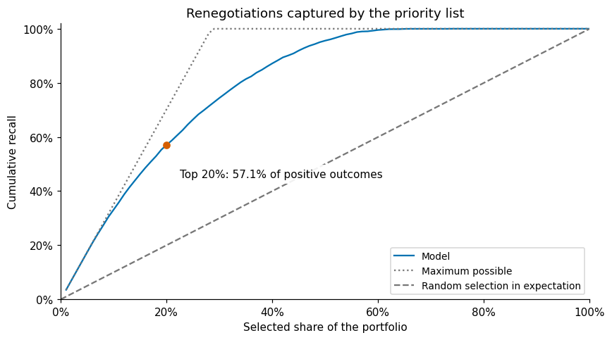
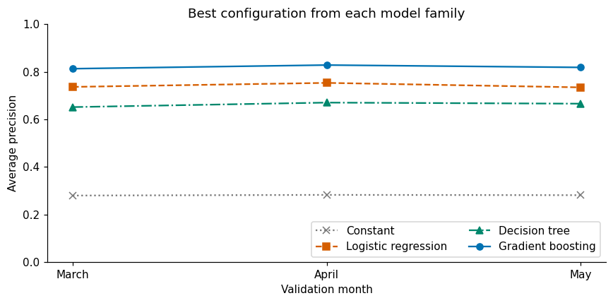
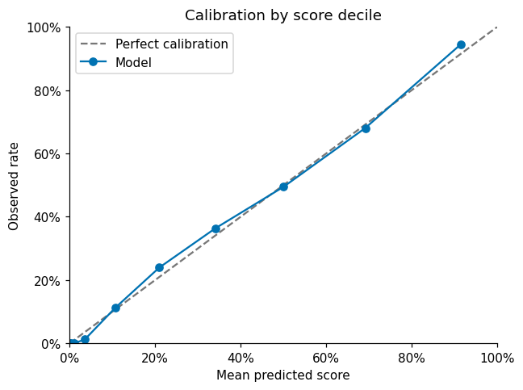

# Debt Renegotiation Prediction

An end-to-end data science case study that ranks customers by their likelihood of renegotiating overdue debt in the following month.

The project covers data cleaning, exploratory analysis, temporal validation, model comparison, feature reduction and capacity-based evaluation. The notebook uses explicit steps, two small helper functions and standard scikit-learn pipelines.

**Author:** Lucas de Souza Lima

**Notebook:** [Open the executed analysis](debt_renegotiation_prediction.ipynb)

## Main result

For June records, the highest-scoring **20% of customers** contained **57.1% of observed renegotiations in July**, with **81.2% precision** and **2.85 lift** over random selection in expectation.

This is a retrospective ranking result. June had already been inspected during development, so it is not an independent test set. The dataset is synthetic, and the target measures renegotiation rather than actual repayment or the causal effect of outreach.



## Problem and data

The input contains 80,000 records with reference months from January to June 2023. The project scope retains 79,909 records for customers aged 18 or older: 66,615 in January–May and 13,294 in June.

The target, `renegociou_no_mes_seguinte`, is 1 when renegotiation occurs in the month after the reference month and 0 otherwise. The intended prediction time is month-end, subject to confirming that all predictors are available by then.

The original CSV is not included in this package. To rerun the analysis, place your copy of `dados_clientes_case.csv` next to the notebook. The executed notebook can be read without that file. Original field names and category codes are preserved; derived features, Python variables, explanations and chart labels are in English.

## Approach

1. **Check and clean the data:** inspect missing values and customer-month keys; apply the age scope; replace negative account tenure with missing values while retaining the original values for audit; normalize product combinations; create missing-value indicators.
2. **Explore January–May:** examine target prevalence, missingness, product and employment groups, overdue balances, days past due and recent history.
3. **Compare four model families:** a constant baseline, logistic regression, a decision tree and histogram-based gradient boosting. Ten configurations use the same 16 features before one-hot encoding.
4. **Validate in time:** fit preprocessing only on training data and use an expanding training window.
5. **Assess the selected model:** compare smaller feature sets, measure grouped permutation importance, select an F1 threshold on validation predictions, and evaluate ranking capacity and calibration on June records.

| Training reference months | Validation reference month |
| --- | --- |
| January–February | March |
| January–March | April |
| January–April | May |

Each reference month's target is renegotiation in the following month. Model selection uses mean average precision (AP) across the three validation months. AP summarizes precision along the ranking, weighted by recall increments. ROC-AUC, Brier score, precision and recall provide complementary checks.

## Results

| Model | Mean validation AP | June AP |
| --- | ---: | ---: |
| Constant baseline | 0.2814 | 0.2846 |
| Logistic regression | 0.7413 | 0.7479 |
| Decision tree | 0.6626 | 0.6647 |
| Gradient boosting | **0.8197** | **0.8271** |

The selected boosting model uses 7 leaves, 300 iterations, a learning rate of 0.08, at least 100 samples per leaf and L2 regularization of 1.0. It is selected by mean validation AP. Its smaller training–validation gap supports that choice, but does not establish the absence of overfitting.



Removing age and segment reduces boosting's mean AP to approximately 0.8165. Also removing recent contact and renegotiation history reduces it to 0.8083, so all 16 features are retained.

The top 20% list contains 2,659 customers and 2,160 positive outcomes. There are 3,784 positive outcomes in the June reference population. A random list of the same size would contain approximately 757 positives in expectation. The F1 threshold selected on March–May predictions is approximately 0.325.



## Run locally

Use Python 3.12. Create an environment and install the dependencies:

```bash
python3.12 -m venv .venv
source .venv/bin/activate
python -m pip install -r requirements.txt
jupyter lab debt_renegotiation_prediction.ipynb
```

On Windows, activate the environment with `.venv\Scripts\Activate.ps1` in PowerShell. You can also open the notebook in VS Code with its Python and Jupyter support.

Place `dados_clientes_case.csv` beside the notebook, then run all cells from top to bottom. The scientific package versions are pinned in `requirements.txt`; JupyterLab provides the notebook interface. The notebook prints the pandas, NumPy and scikit-learn versions used in its execution.

## Input data dictionary

| Original CSV column | Meaning / treatment |
| --- | --- |
| `anomes_abt` | Reference month in `YYYYMM` format; used for temporal splits. |
| `id_cliente` | Customer identifier; excluded from predictors. |
| `nome` | Customer name; excluded from predictors. |
| `idade` | Age in years; retained as a predictor after applying the age scope. |
| `tempo_de_conta_em_anos` | Account tenure in years; negative values become missing. Excluded from predictors because it nearly duplicates age in this dataset. |
| `segmento` | Customer segment code. The meanings of IA, IP and IU are not provided. |
| `att_vinculo_empregaticio` | Employment-status update indicator; retained as supplied. |
| `vinculo_empregaticio` | Employment status: `Empregado` = employed, `Desempregado` = unemployed, `Autônomo` = self-employed. |
| `salario_estimado` | Estimated salary; missing values receive an indicator and training-only median imputation. |
| `saldo_em_conta` | Account balance; handled in the same way as missing salary. |
| `reng_ult_3_meses` | Indicator of renegotiation in the previous three months. |
| `contato_ult_3meses` | Indicator of contact in the previous three months. |
| `qtd_contratos_em_atraso` | Number of overdue contracts; the relationship with product-type counts needs clarification. |
| `saldo_em_atraso` | Overdue balance, in the units supplied by the dataset. |
| `combo_produtos_em_atraso` | Overdue product combination: `CARTAO`, `IMOBILIARIO`, `VEICULO`. Converted to card, mortgage and vehicle indicators. |
| `maior_atraso` | Maximum days past due. |
| `renegociou_no_mes_seguinte` | Binary target: renegotiation in the following month. |

## Limitations and next steps

The six-month synthetic dataset and prior inspection of June limit generalization claims. IDs linked to different names, product-type counts exceeding contract counts and feature availability at prediction time require clarification. Observed associations and permutation importance do not measure causal effects.

Next steps are validation on previously unseen months, monitoring ranking quality and calibration, and an outreach pilot with a control group. Operational capacity, contact costs and actual repayment amounts would be needed to assess financial return.
